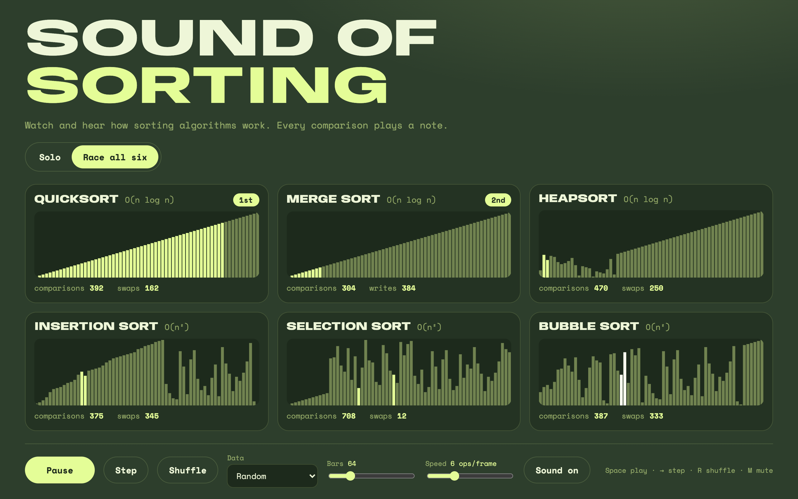

# Sound of Sorting

Watch and hear how sorting algorithms work. Every comparison plays a note: low values sound low, high values sound high. Run one algorithm on its own, or race all six on the same data.

**Live:** [arslanagayev.github.io/sound-of-sorting](https://arslanagayev.github.io/sound-of-sorting/)



## Features

- **Six algorithms:** bubble, insertion, selection, merge, quick and heap sort, each with its best, average and worst case, extra memory and stability.
- **Race mode:** all six sort copies of the same array, one operation each per step, and get 1st to 6th places as they finish. The O(n log n) ones win by a lot, and the gap grows with more bars.
- **Sound:** every operation plays a short triangle-wave note pitched by the value it touches (Web Audio API); a rising sweep plays when an array is sorted.
- **Your own data:** 8 to 256 bars, random, reversed, nearly sorted or few unique values, a seed you can share in the URL (`?mode=race&n=128&data=nearly&seed=3`).
- **Step through it:** pause and press → to follow an algorithm one comparison at a time.
- **Keyboard:** Space play/pause, → step, R shuffle, M mute.

## How it works

```
src/
  core/ops.ts          an operation is a compare, a swap or a write
  core/algorithms.ts   the six sorts as generators that yield one operation per step
  core/runner.ts       applies operations to its own array, counts them, maps values to pitch
  core/session.ts      one algorithm or the six-way race, finishing places, settings in the URL
  core/data.ts         seeded arrays (mulberry32) for every preset
  audio/synth.ts       short blips through the Web Audio API, unlocked on the first click
  ui/draw.ts           draws the bars on a canvas, highlighting the compared and moved ones
  ui/app.ts            the animation loop, the controls and the lanes
```

The algorithms never touch the screen or the speakers: each one is a generator that reads through a read-only probe and yields operations. That one idea makes everything else simple:

- the **runner** applies the operations, so the drawing, the sound and the counters all come from the same stream;
- the **race is fair**, because every lane gets the same number of operations per frame;
- the **tests** can run every algorithm to the end without a browser and check the result.

## Tests

```bash
npm install
npm test        # 53 tests
npm run dev
```

The tests sort every preset at sizes from 0 to 100 with every algorithm and compare against `Array.prototype.sort`, check that operations stay in bounds, and check textbook behaviour in the counts: bubble and insertion sort take exactly n−1 comparisons on sorted input, selection sort always takes n(n−1)/2, and the n log n algorithms need under a quarter of insertion sort's comparisons on 256 random values. The UI is tested in happy-dom with a manual frame scheduler and a fake audio context.

GitHub Actions runs lint, formatting, type-check, tests with coverage and the build on Node 22 and 24, and deploys `main` to GitHub Pages.

## Design

Combo **Lime Sprout #E4FD97** on **Fresh Canopy #2D3E2C**, with Anybody (a variable-width display face) and Space Mono for the numbers.

## License

[MIT](LICENSE)
